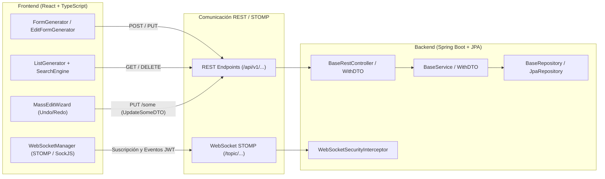

<div align="center">

# ⚡ Spring-React CRUD Toolkit & Accelerator

**A full-stack development accelerator and component toolkit for Spring Boot & React.**

[🇪🇸 Versión en Español](#-versión-en-español) &nbsp;|&nbsp; [🇬🇧 English Version](#-english-version)

</div>

---

# 🇪🇸 Versión en Español

Un ecosistema integral y fuertemente tipado desarrollado en **Spring Boot 3 (Java 21)** y **React 18 (TypeScript)**, diseñado para acelerar drásticamente el desarrollo de aplicaciones web empresariales, reduciendo el código repetitivo (*boilerplate*) en más de un 75% sin sacrificar el rendimiento, la arquitectura limpia ni la seguridad.

---

## 📑 Tabla de Contenidos (Español)
1. [Visión General de la Arquitectura Full-Stack](#1-visión-general-de-la-arquitectura-full-stack)
2. [Sinergia End-to-End: Contrato Cliente-Servidor](#2-sinergia-end-to-end-contrato-cliente-servidor)
3. [Guía de Instalación e Integración (Automatizada y Manual)](#3-guía-de-instalación-e-integración-automatizada-y-manual)
   - [3.1. Modelo de Integración: Proyectos Hermanos](#31-modelo-de-integración-proyectos-hermanos)
   - [3.2. Automatización Multi-Fuente (Python, PowerShell y Bash)](#32-automatización-multi-fuente-python-powershell-y-bash)
   - [3.3. Guía Rápida de Ejecución](#33-guía-rápida-de-ejecución)
   - [3.4. Integración Manual Paso a Paso](#34-integración-manual-paso-a-paso)
   - [3.5. Requisitos y Dependencias (pom.xml y package.json)](#35-requisitos-y-dependencias-pomxml-y-packagejson)
4. [Capa Backend: Componentes Genéricos y Seguridad](#4-capa-backend-componentes-genéricos-y-seguridad)
   - [4.1. BaseRepository y Patrón DTO](#41-baserepositoryt-d-i)
   - [4.2. BaseService y Hooks de Seguridad Opcionales](#42-baseservicet-i-y-patrón-template-method)
   - [4.3. BaseRestController y Edición Masiva (UpdateSomeDTO)](#43-baserestcontroller-y-updatesomedto)
   - [4.4. Seguridad en Tiempo Real: WebSocketSecurityInterceptor](#44-seguridad-en-tiempo-real-websocketsecurityinterceptor)
   - [4.5. Desacoplamiento de Identidad y Utilidades JWT](#45-desacoplamiento-de-identidad-y-utilidades-jwt)
5. [Capa Frontend: Generadores Dinámicos de UI](#5-capa-frontend-generadores-dinámicos-de-ui)
   - [5.1. FormGenerator vs Formik (Eficiencia y Re-renders)](#51-formgenerator-vs-formik)
   - [5.2. EditFormGenerator (Inferencia Automática de Esquemas)](#52-editformgenerator)
   - [5.3. ListGenerator vs TanStack Table y AG Grid](#53-listgenerator-vs-tanstack-table-y-ag-grid)
   - [5.4. MassEditWizard (Flujo Transaccional con Undo/Redo)](#54-masseditwizard)
   - [5.5. SearchBar & SearchEngine (Caché LRU y Búsqueda Avanzada)](#55-searchbar--searchengine)
   - [5.6. DoNotHackMyApp / RouteGuard](#56-donothackmyapp--routeguard)
   - [5.7. ButtonLink (Navegación Limpia)](#57-buttonlink)
   - [5.8. WebSocketManager (Cliente STOMP en Tiempo Real)](#58-websocketmanager)
   - [5.9. Diseño Adaptable y CSS Responsive (vh, vw, rem y Media Queries)](#59-diseño-adaptable-y-css-responsive)
6. [Pruebas Automatizadas y Calidad](#6-pruebas-automatizadas-y-calidad)
   - [6.1. Pruebas de Arquitectura con ArchUnit (Architecture-as-Code)](#61-pruebas-de-arquitectura-con-archunit-17-reglas--archunit-junit-5-tng-technology-consulting)
   - [6.2. Pruebas Unitarias y de Integración Backend](#62-pruebas-unitarias-y-de-integración-backend-101-tests--junit-5-mockito-assertj-spring-mockmvc)
   - [6.3. Pruebas en Frontend](#63-pruebas-en-frontend-141-tests--jest--vitest-react-testing-library-user-event)
7. [Licencia, Autoría y Propiedad Intelectual](#7-licencia-autoría-y-propiedad-intelectual)

---

## 1. Visión General de la Arquitectura Full-Stack

El framework resuelve el ciclo completo de los datos empresariales:



---

## 2. Sinergia End-to-End: Contrato Cliente-Servidor

A diferencia de librerías aisladas de frontend o backend, este framework define un **protocolo sincronizado**:

* **Edición Masiva en Lote:** `MassEditWizard.tsx` permite al usuario modificar múltiples filas con control de versiones en memoria. Al confirmar, envía una petición `PUT /some` con el payload `{ ids: [...], entities: [...] }`.
* **Procesamiento Transaccional:** `BaseRestController.java` recibe exactamente esa estructura mediante `UpdateSomeDTO<I, T>`, y `BaseService.java` ejecuta la actualización en una única transacción atómica (`@Transactional`).
* **Mensajería en Tiempo Real Segura:** `WebSocketManager.ts` encapsula la conectividad STOMP con inyección automática de cabeceras JWT Bearer y restablecimiento de suscripciones ante reconexiones. En el servidor, `WebSocketSecurityInterceptor.java` intercepta el handshake (`CONNECT`), valida las credenciales y aplica políticas de limitación de tasa (*rate limiting*) y control de payload.

---

## 3. Guía de Instalación e Integración (Automatizada y Manual)

Este toolkit ha sido concebido como un acelerador de código reutilizable. Para que cualquier proyecto Spring Boot + React pueda heredar o consumir sus componentes genéricos, controladores, servicios, repositorios, seguridad WebSocket y generadores de UI, se ha diseñado una metodología de importación rápida y **100% automatizada a través de diferentes fuentes**.

### 3.1. Modelo de Integración: Proyectos Hermanos

El principio de integración consiste en situar el repositorio de este toolkit en la **misma carpeta contenedora (directorio padre)** que el proyecto downstream que desea heredar de él:

```text
workspace-proyectos/
├── spring-react-crud-toolkit/      <-- Repositorio clonado de este toolkit
│   ├── backend/...
│   ├── frontend/...
│   └── scripts/                    <-- Scripts de integración automatizada
│       ├── install-toolkit.py      <-- Automatización en Python (Multiplataforma)
│       ├── install-toolkit.ps1     <-- Automatización en PowerShell (Windows)
│       └── install-toolkit.sh      <-- Automatización en Bash (Linux / macOS / WSL)
└── tu-proyecto-spring-boot/        <-- Tu proyecto actual (ej. Upstream-Board-Game, Petclinic, etc.)
    ├── pom.xml
    └── src/main/java/com/empresa/app/...
```

### 3.2. Automatización Multi-Fuente (Python, PowerShell y Bash)

Para maximizar la portabilidad y adaptarse al entorno de desarrollo de cualquier equipo, el proceso de instalación y refactorización está **totalmente automatizado mediante tres scripts nativos independientes**:

| Script | Entorno / Plataforma | Características Clave |
| :--- | :--- | :--- |
| 🐍 [`scripts/install-toolkit.py`](scripts/install-toolkit.py) | **Multiplataforma** (Windows, Linux, macOS) | Requiere Python 3.6+. Sin dependencias externas. Soporte UTF-8 nativo y modo interactivo guiado. |
| 🪟 [`scripts/install-toolkit.ps1`](scripts/install-toolkit.ps1) | **Windows** (PowerShell 5.1 & PowerShell Core 7+) | Integración nativa en terminales Windows. Detección automática de proyectos y generación UTF-8 sin BOM. |
| 🐧 [`scripts/install-toolkit.sh`](scripts/install-toolkit.sh) | **Linux / macOS / WSL / Git Bash** | Script Bash POSIX estándar con coloreado de terminal y pipeline robusto. |

#### ¿Qué realizan estos scripts automáticamente?
1. **Detección inteligente del proyecto y su arquitectura:** Escanean el directorio padre y localizan la carpeta del proyecto destino, detectando tanto layouts monomódulo (`src/main/java`) como multimódulo (`backend/src/main/java`).
2. **Inferencia automática del paquete base:** Inspeccionan la clase principal anotada con `@SpringBootApplication` (por ejemplo `org.springframework.samples.petclinic` o `es.us.dp1.l4_01_24_25.upstream`) y configuran automáticamente el nuevo espacio de nombres (por defecto `<paquete_base>.toolkit`).
3. **Copia estructural de artefactos:** Copian las 17 clases del backend `main` y las 21 suites de prueba de `test` a los directorios que corresponden a la jerarquía de paquetes del proyecto destino.
4. **Refactorización automática de código (*Package & Import Rewriting*):** Renombran en caliente todas las declaraciones `package toolkit...;` y las sentencias `import toolkit...;` para que coincidan con el nuevo paquete de tu proyecto, eliminando cualquier error de importación o colisión de paquetes.
5. **Copia de configuración de test:** Si el proyecto destino no dispone de `src/test/resources/application.properties`, se proporciona la configuración en memoria optimizada para H2 con `spring.sql.init.mode=never`.
6. **Integración opcional de Frontend (`--include-frontend` / `-f`):** Copian de manera sincronizada los componentes React (`FormGenerator`, `EditFormGenerator`, `ListGenerator`, `MassEditWizard`, `SearchBar`, `webSocketManager`, `DoNotHackMyApp`, `ButtonLink`) y utilidades a la carpeta `frontend/src` de tu aplicación.

---

### 3.3. Guía Rápida de Ejecución

#### Paso 1: Clonar el toolkit junto a tu proyecto
Sitúate en la carpeta contenedora donde reside tu proyecto actual y clona este repositorio:
```bash
# Navega al directorio donde reside tu proyecto
cd /ruta/hacia/tus-proyectos/

# Clona el repositorio del toolkit (quedará al mismo nivel de carpetas que tu proyecto)
git clone https://github.com/Ignacio0407/spring-react-crud-toolkit.git
```

#### Paso 2: Ejecutar el script automatizado

Elige cualquiera de las tres opciones según tu sistema operativo o preferencia:

##### Opción A: Python (Multiplataforma - Recomendada)
```bash
# Modo interactivo (te preguntará el proyecto destino y mostrará un menú):
python spring-react-crud-toolkit/scripts/install-toolkit.py

# O bien en una sola línea indicando proyecto y activando frontend:
python spring-react-crud-toolkit/scripts/install-toolkit.py --target mi-proyecto --include-frontend
```

##### Opción B: PowerShell (Windows)
```powershell
# Modo interactivo guiado:
powershell -ExecutionPolicy Bypass -File .\spring-react-crud-toolkit\scripts\install-toolkit.ps1

# O bien indicando parámetros directos:
powershell -ExecutionPolicy Bypass -File .\spring-react-crud-toolkit\scripts\install-toolkit.ps1 -TargetProject "mi-proyecto" -IncludeFrontend
```

##### Opción C: Bash (Linux / macOS / WSL / Git Bash)
```bash
# Modo interactivo guiado:
bash spring-react-crud-toolkit/scripts/install-toolkit.sh

# O bien indicando flags directos:
bash spring-react-crud-toolkit/scripts/install-toolkit.sh -t mi-proyecto -f
```

> [!TIP]
> **Modo Dry-Run:** Todos los scripts soportan el flag `--dry-run` (o `-d` / `-DryRun`) para previsualizar exactamente qué archivos se copiarán y cómo quedarán los paquetes antes de realizar cualquier modificación en disco.

---

### 3.4. Integración Manual Paso a Paso

Si prefieres realizar la integración manualmente sin ejecutar los scripts, el flujo de trabajo es el siguiente:

1. **Copiar las clases del Backend Main:**
   Copia el contenido de `backend/src/main/java/toolkit/` dentro del directorio de código de tu proyecto, ubicándolo en `src/main/java/<tu/paquete/base>/toolkit/`.
2. **Copiar las suites de prueba:**
   Copia el contenido de `backend/src/test/java/toolkit/` en `src/test/java/<tu/paquete/base>/toolkit/`.
3. **Refactorizar `package` e `import`:**
   En todos los archivos Java copiados, reemplaza mediante la función "Replace in Files" de tu editor:
   - `package toolkit;` &rarr; `package <tu.paquete.base>.toolkit;`
   - `package toolkit.` &rarr; `package <tu.paquete.base>.toolkit.`
   - `import toolkit.` &rarr; `import <tu.paquete.base>.toolkit.`
   - `import static toolkit.` &rarr; `import static <tu.paquete.base>.toolkit.`
4. **(Opcional) Copiar Frontend:**
   Copia la carpeta `frontend/src/components/` y las utilidades `interfaces/`, `services/`, `util/` a la carpeta `frontend/src/` de tu aplicación React.

---

### 3.5. Requisitos y Dependencias (pom.xml y package.json)

Para que todos los componentes y pruebas compilen en el proyecto destino, asegúrate de contar con las siguientes dependencias:

#### En `pom.xml` (Backend Spring Boot):
```xml
<!-- Dependencias estándar de Spring Boot 3 -->
<dependency>
    <groupId>org.springframework.boot</groupId>
    <artifactId>spring-boot-starter-web</artifactId>
</dependency>
<dependency>
    <groupId>org.springframework.boot</groupId>
    <artifactId>spring-boot-starter-data-jpa</artifactId>
</dependency>
<dependency>
    <groupId>org.springframework.boot</groupId>
    <artifactId>spring-boot-starter-validation</artifactId>
</dependency>
<dependency>
    <groupId>org.springframework.boot</groupId>
    <artifactId>spring-boot-starter-security</artifactId>
</dependency>
<dependency>
    <groupId>org.springframework.boot</groupId>
    <artifactId>spring-boot-starter-websocket</artifactId>
</dependency>

<!-- Utilidades JWT (JJWT 0.12.x) -->
<dependency>
    <groupId>io.jsonwebtoken</groupId>
    <artifactId>jjwt-api</artifactId>
    <version>0.12.6</version>
</dependency>
<dependency>
    <groupId>io.jsonwebtoken</groupId>
    <artifactId>jjwt-impl</artifactId>
    <version>0.12.6</version>
    <scope>runtime</scope>
</dependency>
<dependency>
    <groupId>io.jsonwebtoken</groupId>
    <artifactId>jjwt-jackson</artifactId>
    <version>0.12.6</version>
    <scope>runtime</scope>
</dependency>
```

#### En `package.json` (Frontend React, si se integra la UI):
```bash
npm install @stomp/stompjs sockjs-client react-hook-form reactstrap bootstrap react-router-dom @fortawesome/fontawesome-free
```

#### Verificación Inmediata:
Ejecuta la suite de pruebas en el proyecto destino para certificar la correcta integración:
```bash
mvn test
```

---

## 4. Capa Backend: Componentes Genéricos y Seguridad

### 4.1. `BaseRepository<T, D, I>`
Extensión de `JpaRepository<T, I>` con soporte nativo de proyecciones DTO:
* `List<D> findAllAsDTO()`: Consultas directas optimizadas que evitan la sobrecarga de hidratación JPA.
* `Optional<D> findByIdAsDTO(I id)`: Búsqueda individual desacoplada del modelo de base de datos.

### 4.2. `BaseService<T, I>` y Patrón Template Method
Servicio base transaccional (`@Transactional`) con operaciones CRUD completas y soporte para **hooks de seguridad y validación opcionales**:

```java
public abstract class BaseService<T, I> {
    // Hooks opcionales extensibles en servicios hijos según reglas de negocio
    protected void checkReadSecurity(I id) {}
    protected void checkCreateSecurity(T entity) {}
    protected void checkUpdateSecurity(I id, T entity) {}
    protected void checkDeleteSecurity(I id) {}

    @Transactional(readOnly = true)
    public T findById(I id) {
        checkReadSecurity(id);
        return this.findOrResourceNotFoundException(this.repository.findById(id), "ID", id);
    }

    @Transactional
    public List<T> updateSome(@Valid List<I> ids, @Valid List<T> updatedEntities) {
        if (ids.size() != updatedEntities.size()) {
            throw new IllegalArgumentException("Ids and entities size mismatch");
        }
        List<T> toSave = new ArrayList<>();
        for (int i = 0; i < ids.size(); i++) {
            T existing = this.findById(ids.get(i));
            updateEntityFields(existing, updatedEntities.get(i));
            toSave.add(existing);
        }
        return this.repository.saveAll(toSave);
    }
}
```

### 4.3. `BaseRestController` y `UpdateSomeDTO`
Expone endpoints estandarizados de forma automática:
* `GET /`: Listado completo.
* `GET /{id}`: Búsqueda por identificador con control de `ResourceNotFoundException`.
* `POST /`: Creación con código `HTTP 201 Created`.
* `PUT /{id}`: Actualización individual.
* `PUT /some`: Actualización por lotes recibiendo `UpdateSomeDTO<I, T>`.
* `DELETE /{id}`: Borrado físico con `HTTP 204 No Content`.

Las variantes `BaseServiceWithDTO` y `BaseRestControllerWithDTO` permiten desacoplar completamente la capa de persistencia de la capa de transporte mediante `EntityMapper<T, D>`.

### 4.4. Seguridad en Tiempo Real: `WebSocketSecurityInterceptor`
Componente crítico basado en `ChannelInterceptor` para asegurar el canal STOMP / WebSocket (frecuentemente desprotegido en aplicaciones web):
1. **Autenticación en Handshake (`CONNECT`):** Valida tokens JWT Bearer presentes en las cabeceras nativas antes de permitir la sesión WebSocket y establece el `SecurityContextHolder`.
2. **Defensa contra DoS (`Rate Limiting`):** Implementa un contador atómico por ventana de tiempo (`AtomicInteger` + `ConcurrentHashMap`) limitando el tráfico por usuario (máximo 60 msg/min) para evitar saturación del broker.
3. **Control de Tamaño de Payload:** Rechaza mensajes superiores a 64 KB previniendo ataques de agotamiento de memoria o inyección masiva.
4. **Validación de Rutas:** Verifica destinos (`/topic/...`) y valida que los identificadores de ruta sean numéricos.

### 4.5. Desacoplamiento de Identidad y Utilidades JWT

#### Desacoplamiento Arquitectónico del Modelo de Usuario
Para maximizar la reusabilidad como librería/acelerador y garantizar que el framework no condicione el diseño de base de datos de las aplicaciones que lo utilicen, el backend ha **desacoplado completamente la gestión de identidades**:
* **Eliminación de entidades y servicios rígidos (`User`, `UserRepository`, `UserDetailsImpl` y `UserDetailsServiceImpl`):** El toolkit ya no impone una entidad JPA `User` ni un repositorio o servicio de usuarios fijo. Forzar una clase `User` en la librería obligaba a los proyectos consumidores a adaptarse a un esquema de base de datos predefinido o a lidiar con conflictos de persistencia. Al eliminar estas clases del núcleo, la aplicación consumidora tiene libertad absoluta para diseñar su propia entidad de usuario (por ejemplo, con campos adicionales, esquemas relacionales complejos, microservicios externos, LDAP, OAuth2 o bases de datos no relacionales).
* **Adhesión a los estándares de Spring Security:** El framework delega la representación del usuario autenticado en la interfaz oficial `org.springframework.security.core.userdetails.UserDetails` y en el contrato de carga `UserDetailsService`, conservando únicamente el enum `Authority` (`ADMIN`, `USER`) como base común. El proyecto que herede o consuma este toolkit solo necesita registrar su propio bean `UserDetailsService` (o instanciar usuarios mediante `org.springframework.security.core.userdetails.User.builder()`), integrándose de forma limpia y estándar.

#### Organización del Paquete `jwt` (`toolkit.configuration.jwt`)
El paquete `jwt` suministra 3 componentes esenciales para la seguridad basada en JSON Web Tokens:
1. **`JwtUtils.java` (Componente Requerido en Toolkit):** Es el **único componente del paquete estrictamente necesario para la operativa interna del toolkit**. Es utilizado por `WebSocketSecurityInterceptor` para verificar firmas criptográficas (algoritmo HS512), fechas de expiración y extraer el nombre de usuario y roles durante el handshake STOMP (`CONNECT`).
2. **`AuthTokenFilter.java` (Componente de Aceleración / *Out-of-the-Box*):** Filtro HTTP (`OncePerRequestFilter`) que intercepta cada petición a la API REST, extrae el token Bearer de la cabecera `Authorization`, lo valida mediante `JwtUtils` y establece la autenticación en el `SecurityContextHolder` empleando el `UserDetailsService` del sistema (omitiendo automáticamente el endpoint de WebSockets `/ws`).
3. **`AuthEntryPointJwt.java` (Componente de Aceleración / *Out-of-the-Box*):** Manejador que implementa `AuthenticationEntryPoint` para capturar accesos no autenticados (`401 Unauthorized`) y emitir respuestas estructuradas en formato JSON en lugar de páginas de error HTML convencionales.

> [!NOTE]
> **¿Por qué se incluyen `AuthTokenFilter` y `AuthEntryPointJwt` si el toolkit no los necesita internamente?**  
> Dos de los tres archivos de la carpeta `jwt` (`AuthTokenFilter` y `AuthEntryPointJwt`) no son consumidos de forma directa por las abstracciones base del toolkit. Sin embargo, se mantienen deliberadamente empaquetados en la librería con el propósito de acelerar el desarrollo del proyecto downstream: cualquier proyecto que herede o consuma el toolkit dispone inmediatamente de una solución de autenticación HTTP JWT lista para producción para enchufar en su `SecurityFilterChain`, evitando tener que implementar desde cero estos componentes esenciales de seguridad.

---

## 5. Capa Frontend: Generadores Dinámicos de UI

Todos los componentes visuales del frontend cuentan con una arquitectura de **diseño adaptable (*responsive*)** implementada mediante unidades relativas fluidas (`vh`, `vw`, `rem`) y *media queries* optimizadas para cualquier resolución y dispositivo (móvil, tableta y escritorio).

### 5.1. FormGenerator vs Formik
* **Rendimiento:** Formik maneja el estado de cada input en React State, re-renderizando todo el formulario en **cada tecla pulsada**. `FormGenerator` se basa en **React Hook Form** (referencias no controladas y suscripciones aisladas), manteniendo cero re-renders innecesarios.
* **Eliminación de Boilerplate:** El formulario se describe mediante un array declarativo `FieldDef[]` en lugar de decenas de etiquetas JSX manuales.

```tsx
const userFields: FieldDef[] = [
  { tag: 'Nombre de usuario', name: 'username', type: 'text', isRequired: true },
  { tag: 'Email', name: 'email', type: 'email', isRequired: true },
  { tag: 'Rol', name: 'role', type: 'select', values: ['PLAYER', 'ADMIN'] }
];

<FormGenerator<UserFormData>
  fields={userFields}
  defaultValues={{ username: '', email: '', role: 'PLAYER' }}
  onSubmit={handleSubmit}
  submitText="Guardar"
/>
```

### 5.2. EditFormGenerator
Detecta automáticamente el tipo de dato de las entidades (texto, numérico, booleano/checkbox, fecha, select, password, email) mediante introspección (`buildFieldsFromEntity`), creando el formulario de edición sin requerir configuración manual de campos.

### 5.3. ListGenerator vs TanStack Table y AG Grid
* Frente a **TanStack Table** (que es 100% *headless* y exige programar toda la UI desde cero), `ListGenerator` proporciona una interfaz interactiva lista para producción.
* Frente a **AG Grid** (cuyo bundle es muy pesado y exige licencias de pago para edición avanzada), `ListGenerator` es ligero y aporta su propio asistente de edición en lote.

### 5.4. MassEditWizard
Permite navegar y editar de forma guiada una colección de registros seleccionados:
* Historial con pila de **Undo / Redo** por cada entidad (`EditTuple<T>`).
* Comparación de estados (`hasChanges`) para evitar tráfico innecesario.
* Modal de revisión comparativa (`ReviewModal`) previa al envío al endpoint `/some`.
* Atajos de teclado: `Ctrl + A` para seleccionar los registros visibles de la página y `Escape` para cancelar el asistente.

### 5.5. SearchBar & SearchEngine
Motor de búsqueda en cliente desacoplado y de alto rendimiento:
* Soporta **rutas anidadas** (`player.profile.nickname`).
* Operadores lógicos `AND` / `OR` y modos de coincidencia (`contains`, `exact`, `startsWith`).
* Optimización con **Caché LRU** (`cacheCapacity = 200`) y **Debounce** (`300ms`).

### 5.6. DoNotHackMyApp / RouteGuard
Interrumpe la renderización de vistas si el usuario no cuenta con los roles o autoridades requeridas, redirigiendo de forma transparente a la pantalla de acceso no autorizado.

### 5.7. ButtonLink
Micro-componente utilitario que unifica un botón Reactstrap con la navegación SPA de React Router en una sola línea limpia.

### 5.8. WebSocketManager
Cliente STOMP fuertemente tipado sobre `@stomp/stompjs` y `sockjs-client` que centraliza la comunicación bidireccional en tiempo real:
* **Autenticación Nativa Integrada:** Inyecta automáticamente el token JWT en las cabeceras `Authorization: Bearer <token>` durante el handshake `CONNECT`.
* **Transporte Dual Flexible:** Permite alternar entre WebSockets nativos (`WebSocket`) y retrocompatibilidad con `SockJS` según la configuración.
* **Resolución Dinámica de URL:** Detección automática del protocolo seguro (`ws:` / `wss:`), host y mapeo de puertos locales vs producción.
* **Gestión de Suscripciones y Resuscripción Automática:** Mantiene una cola interna de tópicos suscritos (`/topic/...`) y los restablece de forma transparente tras pérdidas de conexión.
* **Deserialización Segura:** Parsea de manera tolerante cargas útiles JSON con degradación elegante a cadenas planas.
* **Control de Ciclo de Vida:** Eventos desacoplados `onConnect`, `onDisconnect` y `onError` para una integración limpia con la UI.

```typescript
const wsManager = new WebSocketManager(jwtToken, {
  baseUrl: 'wss://api.example.com/ws',
  events: {
    onConnect: () => console.log('STOMP conectado'),
    onError: (err) => console.error('Error WebSocket:', err)
  }
});

wsManager.addSubscription<UpdatePayload>('matches/dashboard', (data) => {
  updateDashboard(data);
});

wsManager.initConnection();
```

### 5.9. Diseño Adaptable y CSS Responsive

Todos los componentes de interfaz de usuario del frontend están diseñados para ser **completamente adaptables (*responsive*)**, garantizando una visualización y ergonomía óptimas tanto en pantallas de escritorio y portátiles como en tabletas y dispositivos móviles:

* **Estrategia de Unidades Relativas (`vh`, `vw`, `rem`):**
  * **Sustitución de Píxeles Fijos (`px`):** Se eliminaron las medidas estáticas rígidas en favor de un sistema dimensional fluido, previniendo desbordamientos y roturas de maquetación en distintas densidades y relaciones de aspecto.
  * **Uso de `rem` para Tipografías y Espaciados:** Los tamaños de fuente, márgenes, *paddings*, radios de borde (`border-radius`) y grosores de borde se expresan en `rem`. Esto asegura una escala armoniosa que respeta la configuración de accesibilidad y el tamaño de fuente base definido por el usuario en el navegador (*root font size*).
  * **Uso de `vh` y `vw` para Dimensiones del Viewport:** Las alturas de modales y asistentes transaccionales (`max-height: 90vh`), anchos máximos dinámicos (`max-width: 52.08vw`), paddings de contenedores y áreas de visualización (*overlays*) se calculan proporcionalmente a la ventana gráfica, manteniendo proporciones equilibradas tanto en pantallas panorámicas como en pantallas compactas.
* **Adición de Media Queries Específicas:**
  * **Tabletas (`@media (max-width: 1024px)`):** Se incrementan las áreas táctiles de interacción (*touch targets*), aumentando el tamaño y espaciado de botones (`cool-button`), selectores y controles del buscador (`SearchBar`), y ampliando el ancho relativo de los modales transaccionales (`MassEditWizard`) hasta un `80vw`.
  * **Teléfonos Móviles (`@media (max-width: 600px)` y `@media (max-width: 450px)`):**
    * **Formularios Dinámicos (`FormGenerator`, `EditFormGenerator`, `FormInput`):** Los contenedores de campo (`class-form-group`) se expanden al 100% del ancho de pantalla. Los inputs, selectores y textareas fijan un `font-size: 1rem` (16px) como mínimo para evitar que navegadores móviles (especialmente Safari en iOS) apliquen zoom automático invasivo al enfocar el campo. Los botones de acción (`submit` y `cancel`) se ajustan a ancho completo con *box-sizing* para facilitar la pulsación táctil.
    * **Tablas y Edición Masiva (`ListGenerator`, `MassEditWizard`):** Las barras de herramientas horizontales (barra de ordenación `sort-bar` y barra de acciones por lotes `mass-actions-bar`) transicionan dinámicamente a disposición vertical en columna (`flex-direction: column; align-items: stretch`). El modal de edición masiva se expande hasta el `96vw` con bordes redondeados adaptados, y el tamaño de fuente y espaciado de las celdas se ajusta mediante `vw` y `vh` para evitar cualquier desbordamiento horizontal.
    * **Buscador Inteligente (`SearchBar`):** En pantallas pequeñas, el buscador reorganiza y centra las píldoras de filtrado, ubicando la barra de texto en su propia fila completa (100% de ancho) con botón de lupa posicionado de forma accesible.
    * **Accesibilidad y Sensibilidad al Movimiento:** Inclusión de `@media (prefers-reduced-motion: reduce)` en componentes animados (`DoNotHackMyApp`) para usuarios con preferencias de reducción de movimiento en el sistema operativo.

---

## 6. Pruebas Automatizadas y Calidad

El toolkit destaca por un compromiso riguroso con la calidad y la fiabilidad del software, respaldado por un total de **259 pruebas automatizadas (118 en Backend [101 funcionales + 17 reglas arquitectónicas ArchUnit] + 141 en Frontend)** que cubren unitariamente, en integración y a nivel de diseño cada capa del sistema:

| Capa | Archivos / Suites | Tests Automatizados | Tecnologías Clave | Cobertura Funcional |
| :--- | :---: | :---: | :--- | :--- |
| **☕ Backend (Arquitectura)** | 3 suites | **17 reglas** | ArchUnit (TNG), ASM, JUnit 5 | Architecture-as-Code, capas, ciclos, constructor injection y convenciones |
| **☕ Backend (Unitario / Integración)** | 11 suites (+ fixtures) | **101 tests** | JUnit 5, Mockito, AssertJ, Spring MockMvc, JPA | Ciclo CRUD, seguridad WebSocket/JWT, transacciones y entidades |
| **⚛️ Frontend** | 17 suites | **141 tests** | Jest / Vitest, React Testing Library, User Event | Formularios, tablas, wizards, búsqueda, seguridad y WebSockets |
| **🏆 TOTAL** | **31 suites** | **259 tests** | *Stack Unificado Spring Boot + React* | **Cobertura integral End-to-End y Arquitectónica** |


### 6.1. Pruebas de Arquitectura con ArchUnit (**17 reglas** | ArchUnit JUnit 5, TNG Technology Consulting)
Ubicadas en `backend/src/test/java/toolkit/architecture/`. ArchUnit (librería de código abierto originada en **TNG Technology Consulting**) implementa el paradigma **Architecture-as-Code** ("Arquitectura como Código") mediante **Funciones de Fitness Arquitectónicas** (*Architectural Fitness Functions*). Analiza directamente el bytecode compilado (`.class`) mediante **ASM** sin requerir inicializar el contenedor Spring, garantizando en milisegundos que el diseño de software no sufra degradación (*architectural drift* o erosión):

* **`LayerArchitectureTest.java` (5 reglas de capas y dependencias):**
  * **Aislamiento Estricto de Capas (`layeredArchitecture()`):** Define fronteras formales para `Controllers` (`..controller..`), `Services` (`..service..`), `Repositories` (`..repository..`), `Models` (`..model..`) y `Security` (`..security..`, `..configuration..`).
  * **Prohibición de Bypass:** Los controladores tienen prohibido acceder directamente a repositorios (`noClasses().that().resideInAPackage("..controller..").should().dependOnClassesThat().resideInAPackage("..repository..")`), forzando a que toda persistencia pase por la capa de servicio para preservar reglas de negocio y transaccionalidad (`@Transactional`).
  * **Desacoplamiento Web:** Los servicios no pueden depender de controladores de presentación ni clases HTTP.
  * **Independencia de Persistencia:** Los repositorios no pueden depender de capas superiores de servicio.
  * **Grafos Acíclicos de Paquetes (`slices().matching("toolkit.(*)..").should().beFreeOfCycles()`):** Certifica la ausencia absoluta de dependencias circulares entre los paquetes del toolkit.

* **`CodingStandardsTest.java` (6 reglas de Clean Code y buenas prácticas):**
  * **Inyección por Constructor Obligatoria (`NO_CLASSES_SHOULD_USE_FIELD_INJECTION`):** Prohíbe la inyección directa sobre campos (`@Autowired` o `@Value` en atributos privados). Impone la inyección por constructor para favorecer inmutabilidad (`final`), detectar dependencias ausentes en tiempo de compilación y permitir tests unitarios limpios sin reflection hacks.
  * **Logging Estructurado (`NO_CLASSES_SHOULD_ACCESS_STANDARD_STREAMS`):** Proscribe el uso de `System.out`, `System.err` y `printStackTrace()`, forzando el registro mediante SLF4J / Logback.
  * **Jerarquía de Excepciones Tipadas (`NO_CLASSES_SHOULD_THROW_GENERIC_EXCEPTIONS`):** Prohíbe lanzar `Exception` o `Throwable` genéricos desde métodos de negocio.
  * **Estandarización de Logging (`NO_CLASSES_SHOULD_USE_JAVA_UTIL_LOGGING`):** Garantiza que no se utilice `java.util.logging` en favor de SLF4J.
  * **Consistencia de Excepciones:** Toda clase terminada en `Exception` debe heredar de `Throwable` y residir en `toolkit.exception`.
  * **Encapsulación de Entidades JPA:** Prohíbe campos públicos no estáticos en cualquier clase que extienda `BaseEntity`.

* **`SpringConventionsTest.java` (6 reglas de convenciones Spring Boot y Custom Condition):**
  * **Nomenclatura Homogénea:** Los controladores deben nombrarse `*Controller` o derivar de `BaseRestController`, y los servicios deben nombrarse `*Service` o derivar de `BaseService`.
  * **Contrato Spring Data:** Toda interfaz en `toolkit.repository` debe heredar de `org.springframework.data.repository.Repository`.
  * **Centralización de Excepciones:** Las clases anotadas con `@RestControllerAdvice` o `@ControllerAdvice` deben residir en `toolkit.exception`, y todo método `@ExceptionHandler` debe residir dentro de un manejador advice centralizado.
  * **Condición Personalizada de ArchUnit (`ArchCondition<JavaMethod>`):** Demuestra la extensibilidad del Core API de ArchUnit implementando una condición que valida que todo método público en controladores REST devuelva un `ResponseEntity`, garantizando el encapsulado explícito de códigos de estado HTTP y cabeceras.

### 6.2. Pruebas Unitarias y de Integración Backend (**101 tests** | JUnit 5, Mockito, AssertJ, Spring MockMvc)
Ubicadas en `backend/src/test/java/toolkit/`, organizadas por módulos y utilizando fixtures dedicados (`dummy/`) para verificar las abstracciones de forma 100% desacoplada:
* **`WebSocketSecurityTests.java` (23 tests):** Seguridad STOMP/WebSocket en tiempo real: autenticación JWT en handshake `CONNECT`, validación de destinos, control de tamaño de carga útil (máx. 64 KB), rechazo de accesos no autenticados, inyección de `SecurityContextHolder` y rate limiting estricto (60 msg/min por usuario con ventana de reseteo automático).
* **`BaseServiceTest.java` (26 tests):** Validación exhaustiva del ciclo de vida CRUD, control de excepciones `ResourceNotFoundException`, transaccionalidad, métodos hook del patrón Template Method y la lógica atómica de `updateSome` (comprobación de paridad de tamaños, actualización campo a campo y persistencia masiva).
* **`BaseRestControllerTest.java` (14 tests):** Pruebas de integración HTTP mediante MockMvc validando códigos de respuesta (`200 OK`, `201 Created`, `204 No Content`, `404 Not Found`) y el contrato del endpoint `@PutMapping("/some")` con `UpdateSomeDTO`.
* **`BaseRestControllerWithDTOTest.java` (10 tests):** Verificación de endpoints desacoplados mediante DTOs y mappers.
* **`BaseServiceWithDTOTest.java` (10 tests):** Pruebas de mapeo bidireccional DTO-Entidad en operaciones de lectura y guardado.
* **Seguridad y JWT (8 tests):**
  * `JwtUtilsTest.java` (3 tests): Generación, firma criptográfica (HS512), expiración y validación de tokens JWT.
  * `AuthTokenFilterTest.java` (4 tests): Interceptación de peticiones HTTP, extracción del Bearer token y bypass de rutas de WebSocket.
  * `AuthEntryPointJwtTest.java` (1 test): Manejo estructurado de respuestas `401 Unauthorized`.
* **`BaseRepositoryTest.java` (5 tests):** Pruebas de persistencia JPA y proyecciones directas a DTO sin hidratación de entidades.
* **`ModelEntityTest.java` (2 tests):** Comportamiento e igualdad de `BaseEntity` y `NamedEntity`.
* **Manejo Global de Excepciones (3 tests):**
  * `ExceptionHandlerControllerTest.java` (3 tests): Mapeo unificado de excepciones a respuestas estructuradas `ErrorMessage` y códigos HTTP (`404`, `400`, `500`).
*(Nota: Las antiguas suites de prueba `UserDetailsImplTest` y `UserDetailsServiceImplTest` fueron retiradas al desacoplar el modelo de usuario, consolidando un conjunto limpio de 101 tests genéricos e independientes del dominio).*

### 6.3. Pruebas en Frontend (**141 tests** | Jest / Vitest, React Testing Library, User Event)
Ubicadas junto a cada componente en `frontend/src/components/`, cubriendo comportamiento de usuario, accesibilidad y lógica algorítmica:
* **Generación y Manipulación de Listas (48 tests):**
  * `ListGeneratorHelper.test.tsx` (18 tests): Lógica de renderizado, selección masiva, filtrado y helpers.
  * `ListGenerator.Behaviour.test.tsx` (14 tests): Pruebas de interacción con el usuario, selección múltiple y atajos de teclado (`Ctrl + A`, `Escape`).
  * `ListGenerator.test.tsx` (9 tests): Renderizado de columnas, botones de acción y estado visual.
  * `ListGenerator.Matrix.test.tsx` (7 tests): Soporte de matrices de datos heterogéneas y esquemas dinámicos.
* **Ordenación y Paginación (14 tests):**
  * `ListSortBar.test.tsx` (9 tests): Ordenación por columnas ascendente/descendente y cambio dinámico de campos.
  * `ListPagination.test.tsx` (5 tests): Navegación entre páginas, límites y reseteo automático al aplicar filtros.
* **Asistente de Edición Masiva (9 tests):**
  * `MassEditWizard.test.tsx` (6 tests): Flujo paso a paso, pila transaccional de versiones (**Undo / Redo**), detección de cambios reales (`hasChanges`) y envío por lotes.
  * `ReviewModal.test.tsx` (3 tests): Comparativa visual de diferencias (diff) antes de confirmar cambios.
* **Motor de Búsqueda Client-Side (22 tests):**
  * `SearchBar.test.tsx` (11 tests): Renderizado visual, debounce en tiempo real e interacción.
  * `searchEngine.test.ts` (8 tests): Algoritmos de coincidencia (`contains`, `exact`, `startsWith`), operadores lógicos `AND` / `OR`, resolución de rutas anidadas (`a.b.c`) y sensibilidad a mayúsculas/acentos.
  * `useSearchEngine.test.ts` (3 tests): Comportamiento de la caché LRU en memoria y retardo de escritura.
* **Formularios Dinámicos y Esquemas (22 tests):**
  * `FormInput.test.tsx` (9 tests): Renderizado de inputs (texto, número, select, checkbox, fecha, email, password) y vinculación con React Hook Form.
  * `FormGenerator.test.tsx` (8 tests): Validación de esquemas declarativos `FieldDef[]`, manejo de errores y envíos sin re-renders innecesarios.
  * `EditFormGenerator.test.tsx` (5 tests): Inferencia automática de campos a partir de entidades y mapeo de opciones.
* **Seguridad y Navegación (8 tests):**
  * `DoNotHackMyAppHelper.test.ts` (6 tests): Evaluación de roles y autoridades (`roles[0]`, `Authority.ADMIN`) con redirección automática ante accesos no autorizados.
  * `ButtonLink.test.tsx` (2 tests): Integración estilizada de botones Reactstrap y navegación SPA con React Router.
* **Comunicación en Tiempo Real y WebSockets (18 tests):**
  * `webSocketManager.test.ts` (18 tests): Resolución dinámica de URL (localhost, puertos custom, wss), transporte nativo vs SockJS, inyección de token JWT, callbacks del ciclo de vida, cola de suscripción/resuscripción, deserialización de cargas útiles JSON y control de desuscripción.

---

## 7. Licencia, Autoría y Propiedad Intelectual

### Autoría
* **Autor Original:** Ignacio Gutiérrez Serrera
* **GitHub:** [@Ignacio0407](https://github.com/Ignacio0407)
* **Contacto:** [ignaciogutierrezserrera@gmail.com](mailto:ignaciogutierrezserrera@gmail.com)

### Términos de Licencia (Uso No Comercial / Educativo)
* **Uso permitido gratuito:** Se autoriza libremente el uso, copia, estudio y adaptación de este software exclusivamente para **fines personales, académicos, de investigación o demostración en portfolios sin ánimo de lucro**, con la obligación de mantener visible el reconocimiento explícito al autor original.
* **Restricción comercial:** Queda terminantemente prohibido cualquier uso comercial, integración en software privativo o monetización por parte de consultoras o empresas sin la **autorización previa por escrito del autor y la adquisición de una licencia comercial**.
* Para consultas de licenciamiento comercial o contratación: contactar a `ignaciogutierrezserrera@gmail.com`.

---
---

# 🇬🇧 English Version

A comprehensive, strongly typed full-stack ecosystem built with **Spring Boot 3 (Java 21)** and **React 18 (TypeScript)**, designed to dramatically speed up enterprise web application development by cutting down repetitive boilerplate code by over 75% without sacrificing performance, clean architecture, or security.

---

## 📑 Table of Contents (English)
1. [Full-Stack Architecture Overview](#1-full-stack-architecture-overview)
2. [End-to-End Synergy: Client-Server Contract](#2-end-to-end-synergy-client-server-contract)
3. [Installation & Integration Guide (Automated & Manual)](#3-installation--integration-guide-automated--manual)
   - [3.1. Sibling Directory Integration Model](#31-sibling-directory-integration-model)
   - [3.2. Multi-Platform Automation (Python, PowerShell & Bash)](#32-multi-platform-automation-python-powershell--bash)
   - [3.3. Step-by-Step Quickstart Execution](#33-step-by-step-quickstart-execution)
   - [3.4. Alternative Manual Integration Workflow](#34-alternative-manual-integration-workflow)
   - [3.5. Required Dependencies (pom.xml & package.json)](#35-required-dependencies-pomxml--packagejson)
4. [Backend Layer: Generic Components & Security](#4-backend-layer-generic-components--security)
   - [4.1. BaseRepository & DTO Pattern](#41-baserepositoryt-d-i-1)
   - [4.2. BaseService & Template Method Security Hooks](#42-baseservicet-i--template-method-security-hooks)
   - [4.3. BaseRestController & Batch Editing (UpdateSomeDTO)](#43-baserestcontroller--updatesomedto)
   - [4.4. Real-Time Security: WebSocketSecurityInterceptor](#44-real-time-security-websocketsecurityinterceptor)
   - [4.5. User Identity Decoupling & Ready-to-Use JWT Utilities](#45-user-identity-decoupling--ready-to-use-jwt-utilities)
5. [Frontend Layer: Dynamic UI Generators](#5-frontend-layer-dynamic-ui-generators)
   - [5.1. FormGenerator vs Formik (Efficiency & Re-renders)](#51-formgenerator-vs-formik-1)
   - [5.2. EditFormGenerator (Automatic Schema Inference)](#52-editformgenerator-1)
   - [5.3. ListGenerator vs TanStack Table & AG Grid](#53-listgenerator-vs-tanstack-table--ag-grid)
   - [5.4. MassEditWizard (Transactional Flow with Undo/Redo)](#54-masseditwizard-1)
   - [5.5. SearchBar & SearchEngine (LRU Cache & Advanced Search)](#55-searchbar--searchengine-1)
   - [5.6. DoNotHackMyApp / RouteGuard](#56-donothackmyapp--routeguard-1)
   - [5.7. ButtonLink (Clean Navigation)](#57-buttonlink-1)
   - [5.8. WebSocketManager (Real-Time STOMP Client)](#58-websocketmanager-1)
   - [5.9. Responsive Design & Adaptive CSS (vh, vw, rem & Media Queries)](#59-responsive-design--adaptive-css)
6. [Automated Testing & Code Quality](#6-automated-testing--code-quality)
   - [6.1. Architectural Testing with ArchUnit (Architecture-as-Code)](#61-architectural-testing-with-archunit-17-rules--archunit-junit-5-tng-technology-consulting)
   - [6.2. Backend Unit and Integration Tests](#62-backend-unit-and-integration-tests-101-tests--junit-5-mockito-assertj-spring-mockmvc)
   - [6.3. Frontend Tests](#63-frontend-tests-141-tests--jest--vitest-react-testing-library-user-event)
7. [License, Authorship & Intellectual Property](#7-license-authorship--intellectual-property)

---

## 1. Full-Stack Architecture Overview

The framework orchestrates the full lifecycle of enterprise entity data:


---

## 2. End-to-End Synergy: Client-Server Contract

Unlike isolated frontend components or backend libraries, this framework establishes a **coordinated, protocol-driven contract**:

* **Batch Editing:** `MassEditWizard.tsx` guides the user through multi-item edits with client-side version history. Upon confirmation, it dispatches a single `PUT /some` request with the payload `{ ids: [...], entities: [...] }`.
* **Transactional Execution:** `BaseRestController.java` maps this payload to `UpdateSomeDTO<I, T>`, and `BaseService.java` persists the changes in a single atomic transaction (`@Transactional`).
* **Secure Real-Time Messaging:** `WebSocketManager.ts` encapsulates the STOMP connection with automatic JWT Bearer token injection and seamless topic resubscriptions upon reconnection. On the backend, `WebSocketSecurityInterceptor.java` intercepts the handshake (`CONNECT`), verifies credentials, and enforces rate-limiting and payload size policies.

---

## 3. Installation & Integration Guide (Automated & Manual)

This toolkit is designed as a modular software accelerator. To enable any Spring Boot + React project to inherit its generic CRUD abstractions, controllers, services, repositories, real-time WebSocket security, and dynamic UI generators, an automated import workflow has been established **across multiple native script environments**.

### 3.1. Sibling Directory Integration Model

The integration architecture requires placing this cloned toolkit repository inside the **same parent directory** as the consuming project:

```text
workspace-projects/
├── spring-react-crud-toolkit/      <-- Cloned toolkit repository
│   ├── backend/...
│   ├── frontend/...
│   └── scripts/                    <-- Automation scripts
│       ├── install-toolkit.py      <-- Cross-platform Python script
│       ├── install-toolkit.ps1     <-- Windows PowerShell script
│       └── install-toolkit.sh      <-- Unix Bash script (Linux / macOS / WSL)
└── your-spring-boot-project/       <-- Your application (e.g., Upstream-Board-Game, Petclinic, etc.)
    ├── pom.xml
    └── src/main/java/com/mycompany/app/...
```

### 3.2. Multi-Platform Automation (Python, PowerShell & Bash)

To guarantee native performance across any operating system or developer setup, the integration is **fully automated through three dedicated scripts**:

| Script | Environment / OS | Key Features |
| :--- | :--- | :--- |
| 🐍 [`scripts/install-toolkit.py`](scripts/install-toolkit.py) | **Cross-Platform** (Windows, Linux, macOS) | Requires Python 3.6+. Zero external dependencies. Native UTF-8 support and guided interactive menu. |
| 🪟 [`scripts/install-toolkit.ps1`](scripts/install-toolkit.ps1) | **Windows** (PowerShell 5.1 & PowerShell 7+) | Native Windows terminal integration. Project auto-detection and UTF-8 without BOM output. |
| 🐧 [`scripts/install-toolkit.sh`](scripts/install-toolkit.sh) | **Linux / macOS / WSL / Git Bash** | Standard POSIX Bash script with colored CLI output and reliable stream filtering. |

#### What do these scripts automate for you?
1. **Intelligent Project & Layout Detection:** Scans the parent directory to locate your destination project and detects whether it uses a single-module (`src/main/java`) or multi-module layout (`backend/src/main/java`).
2. **Base Package Inference:** Scans Java source files for `@SpringBootApplication` to automatically discover your application's base package (e.g., `org.springframework.samples.petclinic` or `com.mycompany.app`) and configures `<base_package>.toolkit` as the target namespace.
3. **Artifact Tree Copying:** Copies the 17 production classes from `main` and 21 test suites from `test` into the exact folder structure matching the target package.
4. **On-the-Fly Code Refactoring (*Package & Import Rewriting*):** Dynamically rewrites all `package toolkit...;` declarations and `import toolkit...;` statements to match your project's new package structure, preventing compile errors and namespace clashes.
5. **Test Configuration Copying:** Copies `src/test/resources/application.properties` with in-memory H2 settings and `spring.sql.init.mode=never` if missing.
6. **Optional Frontend Integration (`--include-frontend` / `-f`):** Copies React UI components (`FormGenerator`, `EditFormGenerator`, `ListGenerator`, `MassEditWizard`, `SearchBar`, `webSocketManager`, `DoNotHackMyApp`, `ButtonLink`) and core utilities into your app's `frontend/src` directory.

---

### 3.3. Step-by-Step Quickstart Execution

#### Step 1: Clone the toolkit alongside your project
Navigate to the folder containing your application and clone the toolkit:
```bash
# Navigate to the workspace where your project resides
cd /path/to/your-projects/

# Clone spring-react-crud-toolkit as a sibling folder
git clone https://github.com/Ignacio0407/spring-react-crud-toolkit.git
```

#### Step 2: Execute your preferred automation script

##### Option A: Python (Cross-Platform - Recommended)
```bash
# Interactive guided mode (prompts for target and options):
python spring-react-crud-toolkit/scripts/install-toolkit.py

# Non-interactive / single-command execution:
python spring-react-crud-toolkit/scripts/install-toolkit.py --target my-project --include-frontend
```

##### Option B: PowerShell (Windows)
```powershell
# Interactive mode:
powershell -ExecutionPolicy Bypass -File .\spring-react-crud-toolkit\scripts\install-toolkit.ps1

# Direct parameters:
powershell -ExecutionPolicy Bypass -File .\spring-react-crud-toolkit\scripts\install-toolkit.ps1 -TargetProject "my-project" -IncludeFrontend
```

##### Option C: Bash (Linux / macOS / WSL / Git Bash)
```bash
# Interactive mode:
bash spring-react-crud-toolkit/scripts/install-toolkit.sh

# Direct flags:
bash spring-react-crud-toolkit/scripts/install-toolkit.sh -t my-project -f
```

> [!TIP]
> **Dry-Run Mode:** All scripts accept `--dry-run` (or `-d` / `-DryRun`) to preview copied files and package rewrites before making any changes on disk.

---

### 3.4. Alternative Manual Integration Workflow

If you prefer to integrate the toolkit manually without running scripts:

1. **Copy Backend Main Classes:**
   Copy `backend/src/main/java/toolkit/` into your project under `src/main/java/<your/base/package>/toolkit/`.
2. **Copy Test Suites:**
   Copy `backend/src/test/java/toolkit/` into `src/test/java/<your/base/package>/toolkit/`.
3. **Refactor Packages and Imports:**
   Perform a global find-and-replace in your IDE/editor on the copied files:
   - `package toolkit;` &rarr; `package <your.base.package>.toolkit;`
   - `package toolkit.` &rarr; `package <your.base.package>.toolkit.`
   - `import toolkit.` &rarr; `import <your.base.package>.toolkit.`
   - `import static toolkit.` &rarr; `import static <your.base.package>.toolkit.`
4. **(Optional) Copy Frontend:**
   Copy `frontend/src/components/` and utility directories (`interfaces/`, `services/`, `util/`) to your React application's `frontend/src/` folder.

---

### 3.5. Required Dependencies (pom.xml & package.json)

Ensure the following dependencies are included in your target application:

#### In `pom.xml` (Backend Spring Boot):
```xml
<!-- Spring Boot 3 Core Starters -->
<dependency>
    <groupId>org.springframework.boot</groupId>
    <artifactId>spring-boot-starter-web</artifactId>
</dependency>
<dependency>
    <groupId>org.springframework.boot</groupId>
    <artifactId>spring-boot-starter-data-jpa</artifactId>
</dependency>
<dependency>
    <groupId>org.springframework.boot</groupId>
    <artifactId>spring-boot-starter-validation</artifactId>
</dependency>
<dependency>
    <groupId>org.springframework.boot</groupId>
    <artifactId>spring-boot-starter-security</artifactId>
</dependency>
<dependency>
    <groupId>org.springframework.boot</groupId>
    <artifactId>spring-boot-starter-websocket</artifactId>
</dependency>

<!-- JJWT 0.12.x Dependencies -->
<dependency>
    <groupId>io.jsonwebtoken</groupId>
    <artifactId>jjwt-api</artifactId>
    <version>0.12.6</version>
</dependency>
<dependency>
    <groupId>io.jsonwebtoken</groupId>
    <artifactId>jjwt-impl</artifactId>
    <version>0.12.6</version>
    <scope>runtime</scope>
</dependency>
<dependency>
    <groupId>io.jsonwebtoken</groupId>
    <artifactId>jjwt-jackson</artifactId>
    <version>0.12.6</version>
    <scope>runtime</scope>
</dependency>
```

#### In `package.json` (Frontend React):
```bash
npm install @stomp/stompjs sockjs-client react-hook-form reactstrap bootstrap react-router-dom @fortawesome/fontawesome-free
```

#### Verification:
Run the test suites in your project to verify successful integration:
```bash
mvn test
```

---

## 4. Backend Layer: Generic Components & Security

### 4.1. `BaseRepository<T, D, I>`
Extends Spring Data `JpaRepository<T, I>` with out-of-the-box DTO projection methods:
* `List<D> findAllAsDTO()`: Optimized queries that bypass JPA entity hydration overhead.
* `Optional<D> findByIdAsDTO(I id)`: Single entity lookups decoupled from the persistence model.

### 4.2. `BaseService<T, I>` & Template Method Security Hooks
Transactional base service providing full CRUD operations along with **optional extensible security hooks**:

```java
public abstract class BaseService<T, I> {
    // Optional hook methods to be overridden by child services according to domain rules
    protected void checkReadSecurity(I id) {}
    protected void checkCreateSecurity(T entity) {}
    protected void checkUpdateSecurity(I id, T entity) {}
    protected void checkDeleteSecurity(I id) {}

    @Transactional(readOnly = true)
    public T findById(I id) {
        checkReadSecurity(id);
        return this.findOrResourceNotFoundException(this.repository.findById(id), "ID", id);
    }

    @Transactional
    public List<T> updateSome(@Valid List<I> ids, @Valid List<T> updatedEntities) {
        if (ids.size() != updatedEntities.size()) {
            throw new IllegalArgumentException("Ids and entities size mismatch");
        }
        List<T> toSave = new ArrayList<>();
        for (int i = 0; i < ids.size(); i++) {
            T existing = this.findById(ids.get(i));
            updateEntityFields(existing, updatedEntities.get(i));
            toSave.add(existing);
        }
        return this.repository.saveAll(toSave);
    }
}
```

### 4.3. `BaseRestController` & `UpdateSomeDTO`
Exposes standardized RESTful endpoints automatically:
* `GET /`: Retrieve all entities.
* `GET /{id}`: Retrieve by ID with automated `ResourceNotFoundException` handling.
* `POST /`: Create resource with `HTTP 201 Created`.
* `PUT /{id}`: Update individual entity.
* `PUT /some`: Bulk update via `UpdateSomeDTO<I, T>`.
* `DELETE /{id}`: Physical deletion with `HTTP 204 No Content`.

The `BaseServiceWithDTO` and `BaseRestControllerWithDTO` variants allow total decoupling of database models from network payloads using `EntityMapper<T, D>`.

### 4.4. Real-Time Security: `WebSocketSecurityInterceptor`
A crucial `ChannelInterceptor` safeguarding the STOMP / WebSocket channel (frequently neglected in web architectures):
1. **Handshake Authentication (`CONNECT`):** Intercepts and cryptographically validates JWT Bearer tokens from native headers, establishing the `SecurityContextHolder`.
2. **Anti-DoS Rate Limiting:** Implements concurrent atomic bucket tracking (`AtomicInteger` + `ConcurrentHashMap`), limiting traffic per user (maximum 60 messages/min) to prevent broker saturation.
3. **Payload Size Guard:** Rejects frames exceeding 64 KB, mitigating memory exhaustion or buffer overflow vectors.
4. **Route Destination Guard:** Verifies `/topic/...` destinations and enforces numerical constraints on resource parameters.

### 4.5. User Identity Decoupling & Ready-to-Use JWT Utilities

#### Architectural Decoupling of the User Model
To maximize flexibility and prevent opinionated database coupling, the backend **completely decouples user identity management**:
* **Removal of hardcoded identity classes (`User`, `UserRepository`, `UserDetailsImpl`, and `UserDetailsServiceImpl`):** The toolkit no longer ships with a hardcoded JPA `User` entity, user repository, or identity service. Imposing a fixed user schema within a reusable toolkit forced downstream applications to adapt their domain models to arbitrary table structures or resolve persistence conflicts. By removing these classes from the core framework, consuming applications enjoy complete freedom to model users according to their exact domain requirements (e.g., custom attributes, complex relational graphs, OAuth2/OIDC, LDAP, or NoSQL databases).
* **Adherence to Spring Security Standards:** The framework interacts strictly with Spring Security's official `org.springframework.security.core.userdetails.UserDetails` contract and the `UserDetailsService` interface, retaining only the baseline `Authority` enum (`ADMIN`, `USER`). Consuming applications simply register their own `UserDetailsService` bean (or instantiate user principals via `org.springframework.security.core.userdetails.User.builder()`), resulting in a clean, standard, and decoupled integration.

#### Organization of the `jwt` Package (`toolkit.configuration.jwt`)
The `jwt` package groups 3 essential components for JSON Web Token authentication and error handling:
1. **`JwtUtils.java` (Core Required Component):** This is the **only component in the package strictly required for the toolkit's internal runtime**. It is utilized directly by `WebSocketSecurityInterceptor` to verify cryptographic signatures (HS512), validate token expiration, and extract subjects and authorities during the real-time STOMP handshake (`CONNECT`).
2. **`AuthTokenFilter.java` (Accelerator Utility / Out-of-the-Box):** An HTTP `OncePerRequestFilter` that intercepts incoming REST API requests, extracts the Bearer token from the `Authorization` header, validates it via `JwtUtils`, and populates the `SecurityContextHolder` delegating to the application's `UserDetailsService` (automatically bypassing the `/ws` WebSocket endpoint).
3. **`AuthEntryPointJwt.java` (Accelerator Utility / Out-of-the-Box):** A custom `AuthenticationEntryPoint` that intercepts unauthorized access attempts (`401 Unauthorized`) and serializes a clean, structured JSON response rather than default HTML error pages.

> [!NOTE]
> **Why are `AuthTokenFilter` and `AuthEntryPointJwt` included if the core toolkit does not strictly require them?**  
> Two of the three files in the `jwt` package (`AuthTokenFilter` and `AuthEntryPointJwt`) are not internally invoked by the toolkit's base abstractions. However, they are deliberately packaged into the library as an accelerator benefit: any downstream project inheriting or importing the toolkit gets a production-grade HTTP JWT filter and 401 error handler ready to plug directly into its `SecurityFilterChain`, eliminating repetitive security boilerplate.

---

## 5. Frontend Layer: Dynamic UI Generators

All frontend UI components are built with a **responsive and adaptive design architecture**, powered by fluid relative units (`vh`, `vw`, `rem`) and targeted media queries optimized across all viewports and devices (mobile, tablet, and desktop).

### 5.1. FormGenerator vs Formik
* **Performance:** Formik keeps input state in React component state, causing full form re-renders on **every single keystroke**. `FormGenerator` leverages **React Hook Form** (uncontrolled ref subscriptions), maintaining optimal zero-re-render typing performance.
* **Zero Boilerplate:** Forms are declaratively generated from a `FieldDef[]` configuration array instead of dozens of manual JSX tags.

```tsx
const userFields: FieldDef[] = [
  { tag: 'Username', name: 'username', type: 'text', isRequired: true },
  { tag: 'Email', name: 'email', type: 'email', isRequired: true },
  { tag: 'Role', name: 'role', type: 'select', values: ['PLAYER', 'ADMIN'] }
];

<FormGenerator<UserFormData>
  fields={userFields}
  defaultValues={{ username: '', email: '', role: 'PLAYER' }}
  onSubmit={handleSubmit}
  submitText="Save"
/>
```

### 5.2. EditFormGenerator
Introspects entity objects automatically (`buildFieldsFromEntity`) to infer input types (text, number, boolean/checkbox, date, select, password, email), generating full edit views with zero manual field mapping.

### 5.3. ListGenerator vs TanStack Table & AG Grid
* Compared to **TanStack Table** (purely headless, requiring hundreds of lines of UI markup from scratch), `ListGenerator` delivers a complete, production-ready interactive table.
* Compared to **AG Grid** (heavy bundle footprint and high licensing fees for transactional features), `ListGenerator` is lightweight and includes a built-in step-by-step batch edit wizard.

### 5.4. MassEditWizard
Guided step-by-step editing for selected collections of records:
* Version history with an **Undo / Redo** stack per record (`EditTuple<T>`).
* Dirty-checking (`hasChanges`) to eliminate redundant network payloads.
* Pre-flight diff modal (`ReviewModal`) before dispatching batch updates to `/some`.
* Keyboard shortcuts: `Ctrl + A` to toggle all visible rows, `Escape` to dismiss the wizard.

### 5.5. SearchBar & SearchEngine
A decoupled, high-performance client-side search engine:
* Supports **nested object properties** (`player.profile.nickname`).
* Logical operators (`AND` / `OR`) and matching modes (`contains`, `exact`, `startsWith`).
* Optimized with **LRU In-Memory Caching** (`cacheCapacity = 200`) and **Debounce** (`300ms`).

### 5.6. DoNotHackMyApp / RouteGuard
Halts view rendering and performs automatic redirection if the authenticated user lacks required roles or authorities.

### 5.7. ButtonLink
A clean micro-component uniting Reactstrap button styling with React Router SPA navigation in a single line.

### 5.8. WebSocketManager
A strongly typed STOMP client built on `@stomp/stompjs` and `sockjs-client` providing centralized real-time bidirectional communication:
* **Native Integrated Authentication:** Automatically injects JWT Bearer tokens into `Authorization: Bearer <token>` headers during the STOMP `CONNECT` handshake.
* **Dual Transport Flexibility:** Easily toggles between native WebSockets (`WebSocket`) and `SockJS` fallback depending on infrastructure requirements.
* **Dynamic URL Resolution:** Smart discovery of secure protocols (`ws:` / `wss:`), hostnames, and localhost vs production port mapping.
* **Subscription Management & Auto-Resubscription:** Maintains an internal registry of subscribed `/topic/...` destinations and seamlessly restores them after network interruptions.
* **Fault-Tolerant Deserialization:** Gracefully parses incoming JSON payloads with safe fallback to raw string bodies.
* **Lifecycle Hooks:** Decoupled `onConnect`, `onDisconnect`, and `onError` event callbacks for clean UI state integration.

```typescript
const wsManager = new WebSocketManager(jwtToken, {
  baseUrl: 'wss://api.example.com/ws',
  events: {
    onConnect: () => console.log('Connected to STOMP'),
    onError: (err) => console.error('WebSocket Error:', err)
  }
});

wsManager.addSubscription<UpdatePayload>('matches/dashboard', (data) => {
  updateDashboard(data);
});

wsManager.initConnection();
```

### 5.9. Responsive Design & Adaptive CSS

All frontend UI components are built with a **fully responsive and adaptive design**, providing seamless layout restructuring and visual ergonomics across desktops, laptops, tablets, and smartphones:

* **Fluid Relative Units (`vh`, `vw`, `rem`):**
  * **Elimination of Hardcoded Pixels (`px`):** Replaced static pixel dimensions throughout all component stylesheets with fluid, scalable units, eliminating layout breakage across diverse display densities and aspect ratios.
  * **`rem` for Typography and Element Spacing:** Font sizes, margins, paddings, border radii, and stroke widths are expressed in `rem`. This ensures components automatically respect user browser font scaling and zoom accessibility preferences (*root font size*).
  * **`vh` and `vw` for Viewport-Proportional Dimensions:** Modal dialog heights (`max-height: 90vh`), maximum modal widths (`max-width: 52.08vw`), container paddings, and background scenes scale relative to the actual viewport height and width, keeping proportions balanced on ultra-wide monitors and compact laptop screens alike.
* **Targeted Media Queries Across Breakpoints:**
  * **Tablets (`@media (max-width: 1024px)`):** Enlarged interactive touch targets, scaled button heights (`cool-button`), extended search input widths (`SearchBar`), and widened batch edit modals (`MassEditWizard`) up to `80vw`.
  * **Mobile Phones (`@media (max-width: 600px)` & `@media (max-width: 450px)`):**
    * **Dynamic Forms (`FormGenerator`, `EditFormGenerator`, `FormInput`):** Form groups (`class-form-group`) expand to 100% of the available screen width. Text inputs, selects, and textareas enforce a minimum `font-size: 1rem` (16px) to eliminate unwanted automatic viewport zooming on focus in mobile browsers (particularly iOS Safari). Action buttons (`submit` and `cancel`) adapt to full-width layouts with proper box-sizing for touch ergonomics.
    * **Tables & Bulk Editing (`ListGenerator`, `MassEditWizard`):** The column sort bar (`sort-bar`) and mass actions toolbar (`mass-actions-bar`) transition from horizontal layouts to vertical columns (`flex-direction: column; align-items: stretch`). Transactional modals expand up to `96vw` with adjusted corner radii, and table cells leverage `vw`/`vh` sizing to prevent horizontal overflow.
    * **Advanced Search Engine (`SearchBar`):** Search input expands to its own full-width row with the search magnifier button positioned comfortably inside, while filter dropdown pills and toggles center cleanly above it.
    * **Accessibility:** Integrated `@media (prefers-reduced-motion: reduce)` in animated interfaces (`DoNotHackMyApp`) for motion-sensitive users.

---

## 6. Automated Testing & Code Quality

The toolkit demonstrates an exceptional commitment to software reliability and quality, backed by a total of **259 automated tests (118 Backend [101 functional + 17 ArchUnit architectural rules] + 141 Frontend)** covering each layer at the unit, integration, and design levels:

| Layer | Files / Suites | Automated Tests | Core Technologies | Functional Coverage |
| :--- | :---: | :---: | :--- | :--- |
| **☕ Backend (Architecture)** | 3 suites | **17 rules** | ArchUnit (TNG), ASM, JUnit 5 | Architecture-as-Code, layer boundaries, cycles, constructor injection & conventions |
| **☕ Backend (Unit & Integration)** | 11 suites (+ fixtures) | **101 tests** | JUnit 5, Mockito, AssertJ, Spring MockMvc, JPA | Full CRUD lifecycle, WebSocket/JWT security, transactions & entities |
| **⚛️ Frontend** | 17 suites | **141 tests** | Jest / Vitest, React Testing Library, User Event | Forms, interactive tables, wizards, search, security & WebSockets |
| **🏆 TOTAL** | **31 suites** | **259 tests** | *Unified Spring Boot + React Stack* | **Complete End-to-End & Architectural Quality** |


### 6.1. Architectural Testing with ArchUnit (**17 rules** | ArchUnit JUnit 5, TNG Technology Consulting)
Located in `backend/src/test/java/toolkit/architecture/`. ArchUnit (an open-source framework initiated and maintained by **TNG Technology Consulting**) implements **Architecture-as-Code** through **Architectural Fitness Functions**. By analyzing compiled `.class` bytecode directly via **ASM** without spinning up a heavy Spring context, ArchUnit evaluates complex architectural invariants in milliseconds to permanently prevent architectural degradation or erosion:

* **`LayerArchitectureTest.java` (5 layer boundary & dependency rules):**
  * **Strict Layering (`layeredArchitecture()`):** Defines rigid boundaries across `Controllers` (`..controller..`), `Services` (`..service..`), `Repositories` (`..repository..`), `Models` (`..model..`), and `Security` (`..security..`, `..configuration..`).
  * **No Direct Persistence Bypassing:** REST controllers are explicitly forbidden from accessing repositories directly (`noClasses().that().resideInAPackage("..controller..").should().dependOnClassesThat().resideInAPackage("..repository..")`), ensuring all data access flows through transactional service layers (`@Transactional`).
  * **Web Layer Decoupling:** Business services cannot reference HTTP presentation controllers or web artifacts.
  * **Persistence Independence:** Data repositories cannot depend on higher-level service abstractions.
  * **Acyclic Package Graphs (`slices().matching("toolkit.(*)..").should().beFreeOfCycles()`):** Guarantees that packages remain strictly free of circular dependencies.

* **`CodingStandardsTest.java` (6 clean code & quality rules):**
  * **Constructor Injection Enforcement (`NO_CLASSES_SHOULD_USE_FIELD_INJECTION`):** Forbids field injection (`@Autowired` or `@Value` on private attributes). Mandates constructor injection to guarantee field immutability (`final`), fail-fast instantiation, and reflection-free unit testing.
  * **Structured Logging Standards (`NO_CLASSES_SHOULD_ACCESS_STANDARD_STREAMS`):** Eliminates `System.out`, `System.err`, and `e.printStackTrace()` in favor of SLF4J / Logback.
  * **Typed Exception Hierarchy (`NO_CLASSES_SHOULD_THROW_GENERIC_EXCEPTIONS`):** Forbids methods from throwing unhandled generic `Exception` or `Throwable`.
  * **Logging Framework Standardization (`NO_CLASSES_SHOULD_USE_JAVA_UTIL_LOGGING`):** Enforces SLF4J across the toolkit.
  * **Domain Exception Integrity:** Classes named `*Exception` must inherit from `Throwable` and reside within `toolkit.exception`.
  * **JPA Entity Encapsulation:** Prohibits non-static public fields across all entities inheriting from `BaseEntity`.

* **`SpringConventionsTest.java` (6 Spring Boot conventions & Custom ArchCondition):**
  * **Consistent Component Naming:** Controllers must be named `*Controller` or extend `BaseRestController`; services must be named `*Service` or extend `BaseService`.
  * **Spring Data Repository Abstraction:** Interfaces in `toolkit.repository` must extend Spring Data's `Repository`.
  * **Centralized Advice:** `@RestControllerAdvice` and `@ControllerAdvice` beans must reside in `toolkit.exception`, and all `@ExceptionHandler` methods must be declared within these advice handlers.
  * **Custom ArchCondition (`ArchCondition<JavaMethod>`):** Illustrates ArchUnit's deep extensibility by creating a custom condition verifying that public REST controller endpoints return `ResponseEntity` wrappers rather than bare domain entities, guaranteeing explicit HTTP status codes and headers.

### 6.2. Backend Unit and Integration Tests (**101 tests** | JUnit 5, Mockito, AssertJ, Spring MockMvc)
Located in `backend/src/test/java/toolkit/`, structured by module and using dedicated test fixtures (`dummy/`) to verify generic base abstractions in complete isolation:
* **`WebSocketSecurityTests.java` (23 tests):** Real-time STOMP/WebSocket security: JWT authentication on handshake `CONNECT`, destination validation, payload size constraints (max 64 KB), unauthenticated request rejection, `SecurityContextHolder` population, and strict per-user rate limiting (60 msg/min with automatic sliding window reset).
* **`BaseServiceTest.java` (26 tests):** Comprehensive verification of the CRUD lifecycle, `ResourceNotFoundException` handling, transactionality, Template Method hook execution, and atomic batch updates via `updateSome` (size mismatch validation, field-by-field updates, and batch persistence).
* **`BaseRestControllerTest.java` (14 tests):** MockMvc integration tests validating HTTP status codes (`200 OK`, `201 Created`, `204 No Content`, `404 Not Found`) and the `@PutMapping("/some")` batch contract with `UpdateSomeDTO`.
* **`BaseRestControllerWithDTOTest.java` (10 tests):** End-to-end verification of controller endpoints decoupled with DTOs and entity mappers.
* **`BaseServiceWithDTOTest.java` (10 tests):** Bidirectional DTO-to-Entity mapping across read and write operations.
* **Security & JWT (8 tests):**
  * `JwtUtilsTest.java` (3 tests): JWT token generation, cryptographic signing (HS512), expiration handling, and validation.
  * `AuthTokenFilterTest.java` (4 tests): HTTP request interception, Bearer token extraction, and WebSocket path bypass.
  * `AuthEntryPointJwtTest.java` (1 test): Structured `401 Unauthorized` response formatting.
* **`BaseRepositoryTest.java` (5 tests):** JPA persistence queries and direct DTO projections avoiding full entity hydration.
* **`ModelEntityTest.java` (2 tests):** Behavior and equality semantics for `BaseEntity` and `NamedEntity`.
* **Global Exception Handling (3 tests):**
  * `ExceptionHandlerControllerTest.java` (3 tests): Global REST exception resolution to standardized `ErrorMessage` responses and HTTP status codes (`404`, `400`, `500`).
*(Note: Former test suites `UserDetailsImplTest` and `UserDetailsServiceImplTest` were removed alongside the decoupled user model, yielding a lean, 100% generic test suite of 101 domain-agnostic tests).*

### 6.3. Frontend Tests (**141 tests** | Jest / Vitest, React Testing Library, User Event)
Colocated with components in `frontend/src/components/`, validating user behavior, accessibility, and algorithmic correctness:
* **List Generation & Table Interactions (48 tests):**
  * `ListGeneratorHelper.test.tsx` (18 tests): Core rendering logic, bulk selection helpers, and data transformations.
  * `ListGenerator.Behaviour.test.tsx` (14 tests): User interaction flows, keyboard shortcuts (`Ctrl + A`, `Escape`), and multi-row selection.
  * `ListGenerator.test.tsx` (9 tests): Dynamic column rendering, custom action buttons, and visual state management.
  * `ListGenerator.Matrix.test.tsx` (7 tests): Heterogeneous data matrices and dynamic entity schemas.
* **Sorting & Pagination (14 tests):**
  * `ListSortBar.test.tsx` (9 tests): Ascending/descending column sorting and active field toggles.
  * `ListPagination.test.tsx` (5 tests): Page navigation, boundary conditions, and automatic reset upon filtering.
* **Mass Edit Wizard (9 tests):**
  * `MassEditWizard.test.tsx` (6 tests): Guided multi-step editing, version-controlled **Undo / Redo** stack, dirty-checking (`hasChanges`), and batch submission.
  * `ReviewModal.test.tsx` (3 tests): Pre-flight visual diffing comparing original vs. modified entity values.
* **Client-Side Search Engine (22 tests):**
  * `SearchBar.test.tsx` (11 tests): UI rendering, real-time debounce, and filter input controls.
  * `searchEngine.test.ts` (8 tests): Matching modes (`contains`, `exact`, `startsWith`), logical `AND` / `OR` operators, nested path resolution (`a.b.c`), and diacritics/case sensitivity.
  * `useSearchEngine.test.ts` (3 tests): In-memory LRU cache eviction and typing debounce timing.
* **Dynamic Forms & Schema Generation (22 tests):**
  * `FormInput.test.tsx` (9 tests): Input field rendering (text, number, select, checkbox, date, email, password) and React Hook Form integration.
  * `FormGenerator.test.tsx` (8 tests): Declarative `FieldDef[]` schemas, error triggering, and submit handling without extraneous re-renders.
  * `EditFormGenerator.test.tsx` (5 tests): Automated entity introspection and dynamic select option binding.
* **Security & Navigation (8 tests):**
  * `DoNotHackMyAppHelper.test.ts` (6 tests): Role and authority evaluation (`roles[0]`, `Authority.ADMIN`) with automatic unauthorized redirection.
  * `ButtonLink.test.tsx` (2 tests): Styled Reactstrap buttons coupled with React Router SPA navigation.
* **Real-Time Communication & WebSockets (18 tests):**
  * `webSocketManager.test.ts` (18 tests): Dynamic URL resolution (localhost, custom ports, wss), native WebSocket vs SockJS transport, JWT credential injection, lifecycle callbacks, subscription/resubscription queues, JSON payload parsing, and unsubscription handling.

---

## 7. License, Authorship & Intellectual Property

### Authorship
* **Original Author:** Ignacio Gutiérrez Serrera
* **GitHub:** [@Ignacio0407](https://github.com/Ignacio0407)
* **Contact:** [ignaciogutierrezserrera@gmail.com](mailto:ignaciogutierrezserrera@gmail.com)

### License Terms (Non-Commercial / Educational Use)
* **Free Permitted Use:** Permission is granted to inspect, study, copy, and adapt this software exclusively for **personal development, academic, university, scientific research, or non-commercial portfolio demonstration purposes**, provided that explicit credit and authorship attribution are maintained.
* **Commercial Restrictions:** Any commercial exploitation, incorporation into closed-source or proprietary software, or monetization by companies/consultancies is strictly prohibited without **prior explicit written permission and the acquisition of a commercial license from the author**.
* For commercial licensing, enterprise inquiries, or hiring: contact `ignaciogutierrezserrera@gmail.com`.
